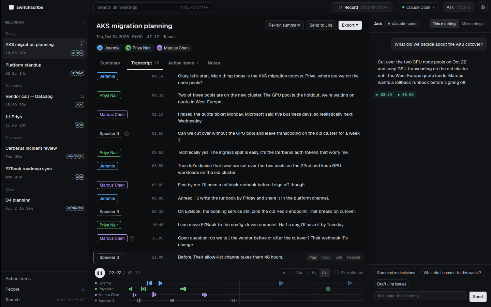
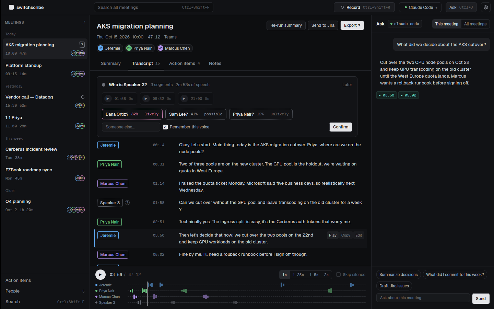
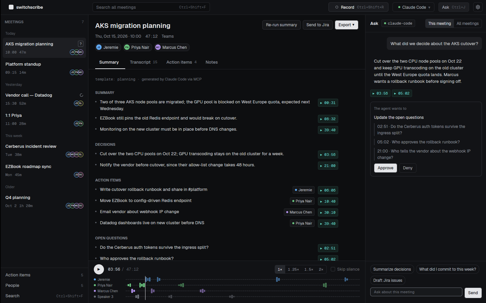
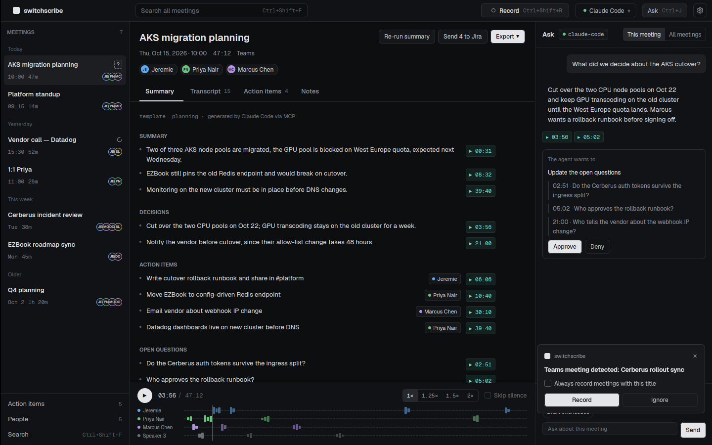
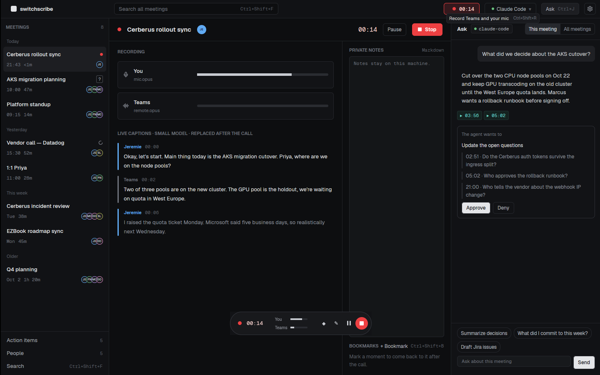
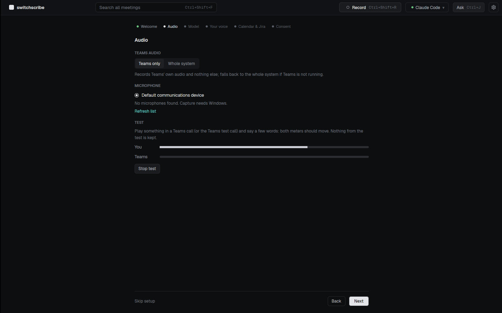
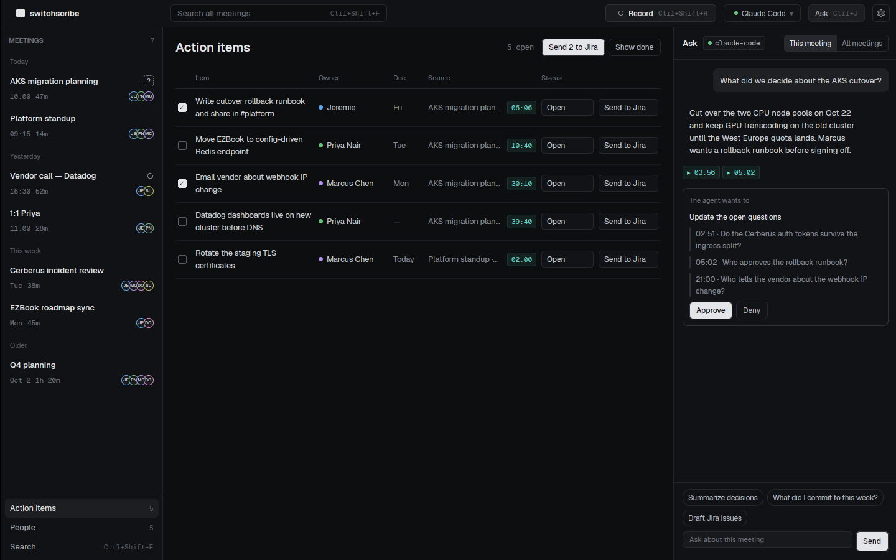

# switchscribe

**A local-first meeting recorder and transcriber for Teams, in Rust and GPUI.**

switchscribe records Teams calls on Windows without a bot joining, transcribes them on
your machine, names who spoke, and turns each meeting into searchable notes and action
items that your coding CLI (Claude Code, Codex, Gemini CLI) can query. It is a sibling of
[switchhead](https://github.com/jeremielumandong/switchhead) and Switchyard and shares
their GPUI stack and design system.

> Early development. All seven milestones, **M0 (skeleton)** through **M6 (live and
> polish)**, are built and waiting on real-machine checks on Windows: the app shell, the SQLite store, recording Teams plus your mic to two Opus tracks
> with a live view, a floating mini recorder and a tray icon, on-device Whisper
> transcription after the call, an audio player synced to the transcript, speaker
> identification with a voiceprint library, summaries and action items written by your
> coding CLI, the Ask panel and an MCP server, a Record prompt when a Teams call starts,
> meeting names and invitees from your Outlook calendar, action items sent to Jira, and
> Markdown, Word, SRT, VTT and JSON exports, live captions, first-run setup, a per-user
> installer and in-app updates. See
> [`PLAN.md`](PLAN.md) and the full [build plan](docs/BUILD-PLAN.md).
















## Install

Download `switchscribe-setup-<version>-x64.exe` from
[Releases](https://github.com/jeremielumandong/switchscribe/releases) and run it. It
installs for your account only (no admin rights), can start with Windows in the tray, and
updates itself from the title bar's Update button. Uninstalling keeps your data folder.

Releases also carry a universal macOS `.dmg` and a Linux `.AppImage`. Recording is
Windows-only for now; on macOS and Linux switchscribe opens, plays, transcribes and searches
meetings. Cutting a release is described in [`packaging/README.md`](packaging/README.md).

## Run it

```bash
cargo run -p switchscribe-app             # binary: `switchscribe`
cargo run -p switchscribe-app -- --demo   # the prototype's meetings, in memory only
```

Building needs CMake and a C++ compiler (libopus and whisper.cpp are compiled from
source). Linux needs `libxkbcommon-dev`, `libxkbcommon-x11-dev`, `libwayland-dev`,
`libxcb1-dev`, `libvulkan-dev`, `libfontconfig-dev` and `libasound2-dev` to build.

Transcription runs on this machine with a Whisper model you download from Settings →
Models (Small is a good start on a laptop; the quantized Large v3 Turbo with a GPU).
Speaker identification needs the 47 MB speaker models, fetched with the first
transcription model. The sherpa-onnx and onnxruntime shared libraries the build
downloads must stay next to the executable.

| Variable | Effect |
| --- | --- |
| `SWITCHSCRIBE_DATA` | Data folder (default `%APPDATA%\switchscribe`, or the platform data dir) |
| `SWITCHSCRIBE_DEMO=1` | Same as `--demo` |
| `SWITCHSCRIBE_FAKE_AUDIO=1` | Record two synthetic voices instead of the devices (any OS; the demo always does) |
| `SWITCHSCRIBE_FAKE_MEETING=<title>` | Pretend a Teams call named `<title>` starts a few seconds after launch (any OS) |
| `SWITCHSCRIBE_ONBOARDING=1` / `0` | Show first-run setup (even in the demo) / never show it |
| `SWITCHSCRIBE_ZOOM` | UI zoom, `0.7`–`2.0` |
| `SWITCHSCRIBE_LOG` | Log filter, e.g. `debug` |

## Your coding CLI

Summaries and the Ask panel run the coding CLI you pick in the title bar (Claude Code,
Codex or Gemini CLI) headless, with its own sign-in. To ask about meetings from your own
terminal sessions, add switchscribe as an MCP server (Settings → Agent has the exact
line):

```bash
claude mcp add switchscribe -- "<path to switchscribe>" mcp
```

`switchscribe mcp --ask` makes every write (summary edits, Jira issues) wait for your
approval in the app.

## Calendar and Jira

Settings → Integrations connects both; neither is needed to record.

- **Outlook calendar** names meetings and suggests invitees when naming speakers. Either
  register an app in Microsoft Entra ID (public client flows on, delegated
  `Calendars.Read`), paste its client ID and sign in with the device code shown, or, if
  your tenant blocks that, publish your calendar from Outlook (Settings → Calendar →
  Shared calendars → Publish) and paste the ICS link.
- **Jira Cloud** takes your site, email, an API token from id.atlassian.com and a
  project key. Send one action item, tick several on the Action items screen, or approve
  an issue the agent proposes. Each issue quotes its transcript line and links back to
  the moment with `switchscribe://meeting/<id>?t=<seconds>`.

The token and the Microsoft sign-in are stored sealed with Windows DPAPI.

## Layout

```
crates/
  app/           switchscribe-app           GPUI binary `switchscribe`: shell, screens
  capture/       switchscribe-capture       Teams loopback + mic to Opus tracks (WASAPI)
  pipeline/      switchscribe-pipeline      VAD, transcription, diarization, merge (M2, M3)
  speakers/      switchscribe-speakers      voiceprints and matching (M3)
  store/         switchscribe-store         data folder, SQLite + FTS5, settings
  agent/         switchscribe-agent         MCP server, CLI runner, templates (M4)
  integrations/  switchscribe-integrations  Outlook calendar, Jira, exports (M5)
vendor/          the application-patched GPUI Fast stack (shared with switchhead)
docs/            build plan, decisions, the UI prototype
```

## Your data

Everything stays on your machine: one folder per meeting under the data folder's
`meetings/` (`mic.opus`, `remote.opus`, `capture.json`, `notes.md`, `transcript.json`,
`speakers.json`), a SQLite index (`switchscribe.db`, with voiceprints sealed by Windows
DPAPI) and `settings.json`. Audio, transcripts and voiceprints never leave. What does:
transcript text your chosen CLI sends to its model for summaries and answers (a CLI
running a local model keeps even that here), the action items you send to Jira with
their quoted line, and calendar requests to Microsoft or your ICS link.

## License

MIT. GPUI and gpui-component are Apache-2.0; Geist is OFL
(`crates/app/assets/fonts/OFL-Geist.txt`).
