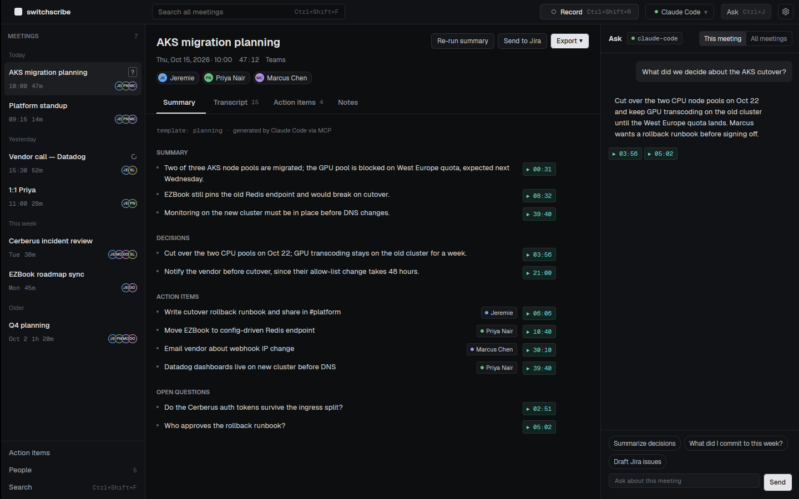
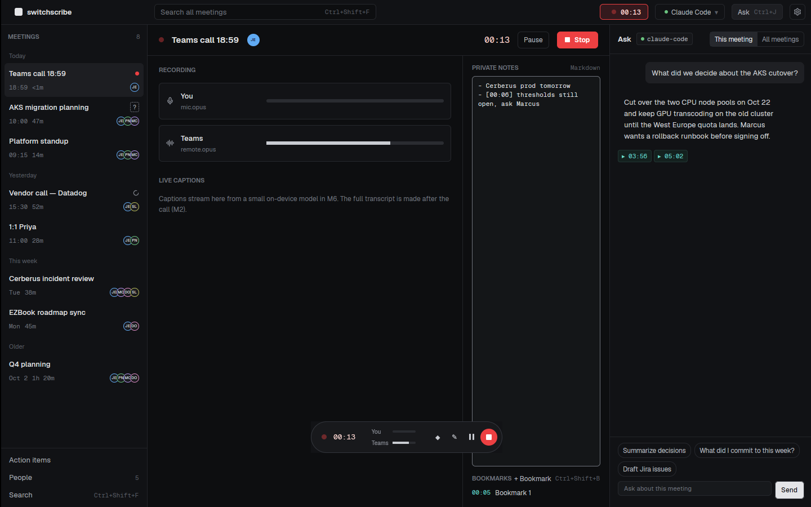

# switchscribe

**A local-first meeting recorder and transcriber for Teams, in Rust and GPUI.**

switchscribe records Teams calls on Windows without a bot joining, transcribes them on
your machine, names who spoke, and turns each meeting into searchable notes and action
items that your coding CLI (Claude Code, Codex, Gemini CLI) can query. It is a sibling of
[switchhead](https://github.com/jeremielumandong/switchhead) and Switchyard and shares
their GPUI stack and design system.

> Early development. **M0 (skeleton)**, **M1 (capture)** and **M2 (transcription)** are
> in: the app shell, the SQLite store, recording Teams plus your mic to two Opus tracks
> with a live view, a floating mini recorder and a tray icon, on-device Whisper
> transcription after the call, and an audio player synced to the transcript. Speaker
> naming arrives in M3. See
> [`PLAN.md`](PLAN.md) and the full [build plan](docs/BUILD-PLAN.md).





## Run it

```bash
cargo run -p switchscribe-app             # binary: `switchscribe`
cargo run -p switchscribe-app -- --demo   # the prototype's meetings, in memory only
```

Building needs CMake and a C++ compiler (libopus and whisper.cpp are compiled from
source). Linux needs `libxkbcommon-dev`, `libxkbcommon-x11-dev`, `libwayland-dev`,
`libxcb1-dev`, `libvulkan-dev`, `libfontconfig-dev` and `libasound2-dev` to build.

Transcription runs on this machine with a Whisper model you download from Settings →
Models (Small is a good start on a laptop; the quantized Large v3 Turbo with a GPU).

| Variable | Effect |
| --- | --- |
| `SWITCHSCRIBE_DATA` | Data folder (default `%APPDATA%\switchscribe`, or the platform data dir) |
| `SWITCHSCRIBE_DEMO=1` | Same as `--demo` |
| `SWITCHSCRIBE_FAKE_AUDIO=1` | Record two synthetic voices instead of the devices (any OS; the demo always does) |
| `SWITCHSCRIBE_ZOOM` | UI zoom, `0.7`–`2.0` |
| `SWITCHSCRIBE_LOG` | Log filter, e.g. `debug` |

## Layout

```
crates/
  app/           switchscribe-app           GPUI binary `switchscribe`: shell, screens
  capture/       switchscribe-capture       Teams loopback + mic to Opus tracks (WASAPI)
  pipeline/      switchscribe-pipeline      VAD, transcription, diarization, merge (M2, M3)
  speakers/      switchscribe-speakers      voiceprints and matching (M3)
  store/         switchscribe-store         data folder, SQLite + FTS5, settings
  agent/         switchscribe-agent         MCP server, CLI runner, templates (M4)
  integrations/  switchscribe-integrations  Outlook calendar, Jira, exports (M5)
vendor/          the application-patched GPUI Fast stack (shared with switchhead)
docs/            build plan, decisions, the UI prototype
```

## Your data

Everything stays on your machine: one folder per meeting under the data folder's
`meetings/` (`mic.opus`, `remote.opus`, `capture.json`, `notes.md`), a SQLite index
(`switchscribe.db`) and `settings.json`. The only thing that
ever leaves is transcript text you send to your chosen CLI's model for summaries.

## License

MIT. GPUI and gpui-component are Apache-2.0; Geist is OFL
(`crates/app/assets/fonts/OFL-Geist.txt`).
